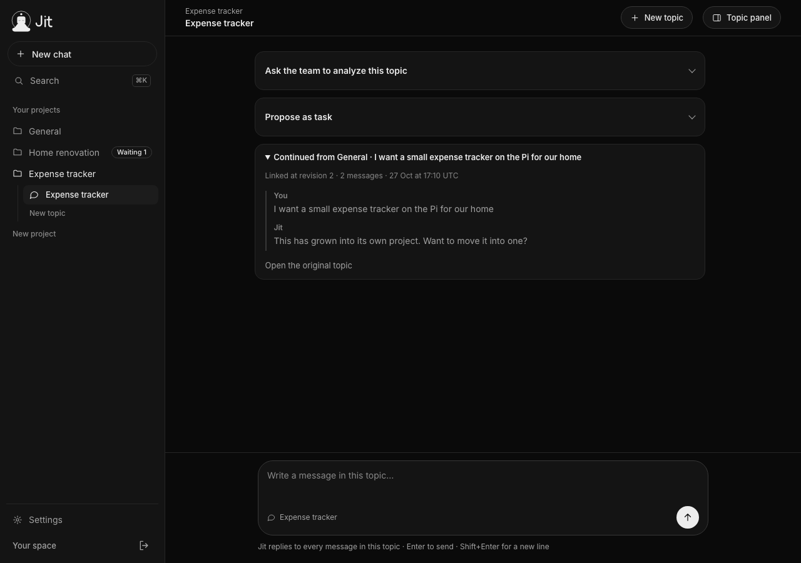
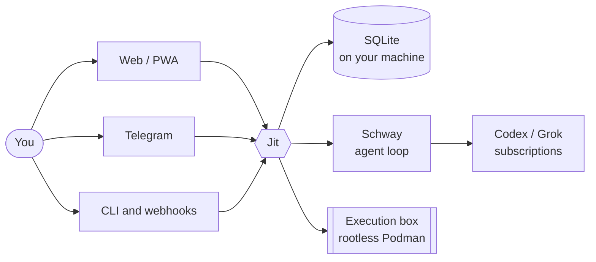

<div align="center">

<picture>
  <source media="(prefers-color-scheme: dark)" srcset="docs/design/assets/lockup-dark.svg">
  
</picture>

### Just in time. Just for you.

A self-hosted AI team for your software projects.<br>
Chat with one assistant, bring in specialists when needed, and pick up where you left off the next day.

[](LICENSE)
[](https://bun.sh)
[](tsconfig.json)
[](docs/runbooks/ops-service.md)

**English** · [ไทย](README.th.md)



</div>

---

## What is Jit?

Jit is a personal assistant that runs on a machine you control, such as a Raspberry Pi. You talk to **Jit**, the main bot. Jit answers every message, suggests specialists when a topic needs them, and asks them for independent analyses. It remembers decisions, tasks and their sources across projects and across days.

Jit uses [Schway](https://github.com/chayapats/schway) as its execution engine. Schway runs the agent loop and the provider sessions. Jit handles everything else: projects, the team, memory, tasks, jobs and channels.

## Highlights

|  |  |
| --- | --- |
| **Chat-first** | A Grok-style Web app, dark and light, in Thai and English. You can install it as a PWA. |
| **A team on demand** | Jit drafts specialists as cards, and a role exists only after you press **Create**. Jit may call existing roles only within the allowance you set. |
| **Memory with sources** | Every claim links back to where it came from. You can correct it or tell Jit to forget it, and the change carries through everywhere it was used. |
| **Tasks you accept** | A proposal becomes a task only when you accept that exact revision. Accepting a task does not start any work. |
| **Private PR review** | Jit reads new pull requests without running them and sends you findings with evidence. |
| **Quiet by default** | Scheduled runs with nothing new stay silent. You get one notice per finished batch of work, either for everything or only for what needs you. |
| **Sandboxed execution** | Each project gets one rootless Podman box. Access is Read, Workspace or Full, and only you can raise it. Pushes, deploys and other external effects wait for your approval card. |
| **Reach it your way** | Web, a loopback CLI (`jit ask`), signed webhooks, and an `.ics` feed of your schedules. The Telegram channel is built, but no live Bot API transport ships yet. |

## How it works



## Principles

- **Authority comes from you.** Model output and retrieved content can never create roles, tasks or decisions, and they cannot widen access.
- **Proposed, accepted and done stay separate.** Every change has a revision and a receipt you can inspect.
- **Your data stays on your host.** Jit sends no telemetry. Data goes out only to the model providers, channels and repositories you configure.
- **Credentials stay out of the box.** No Jit credential, database or backup ever enters the execution box.

## Status

Jit is in **pilot** with a single owner. The MVP and specs S09–S11 are implemented. On 2026-10-28, a Raspberry Pi 5 install passed packaging, restart, reboot and route-readiness gates on the **Codex** route. The Grok route is deferred until its quota resets, and Telegram stays disabled until a live transport ships. Each installation supports one owner.

## Quick start

You need [Bun](https://bun.sh) 1.4.2 or later. You do not need a subscription or a Schway build to develop.

```sh
bun install --frozen-lockfile
bun run setup        # create the owner (password: 12–256 chars, read from the terminal)
bun start            # http://localhost:3000
```

Open `http://localhost:3000`, sign in, and follow the first-run **ตั้งจิต** flow to set Jit's persona. Replies come from scripted fixtures by default. To use real models, set `JIT_RUN_PORT=schway`. First give the user that runs Jit an unlocked Secret Service and a Schway provider login (see [Pi live round](docs/runbooks/pi-live-round.md), Round B).

> [!TIP]
> If you forget the password, run `bun run owner:reset` on the host. It revokes old sessions and keeps your projects. There is no remote reset.

## Configuration

Jit reads its settings from environment variables. The most common ones:

| Variable | Default | Purpose |
| --- | --- | --- |
| `JIT_DATABASE` | `.local/jit.sqlite` | Application database (ignored by git, mode 0600) |
| `JIT_ORIGIN` | `http://localhost:3000` | The one exact origin. Use HTTPS for anything other than loopback |
| `JIT_HOST` / `JIT_PORT` | `127.0.0.1` / `3000` | Listen address |
| `JIT_RUN_PORT` | `scripted` | `scripted` (fixtures) or `schway` (live routes) |
| `JIT_SESSION_SECONDS` | `28800` | Browser session lifetime |

See [`src/config.ts`](src/config.ts) for the full list with limits, including job, Telegram and execution-box settings.

> [!IMPORTANT]
> For remote access, put Jit behind an HTTPS reverse proxy on your VPN that preserves `Host`. Never expose the backend port directly. Jit does not trust `Forwarded` headers, and being on the VPN does not count as owner identity.

## Deploy

| Guide | Covers |
| --- | --- |
| [Service install and upgrade](docs/runbooks/ops-service.md) | Build, plan, install and upgrade the systemd service |
| [Execution box](docs/runbooks/execution-box.md) | Rootless Podman setup and `box-doctor` |
| [Pi live round](docs/runbooks/pi-live-round.md) | Host, subscription and reboot evidence on a Pi |
| [Load drill](docs/runbooks/ops-load-drill.md) | Capacity and release-evidence drills |

## Development

```sh
bun test             # deterministic: scripted models, protocol fixtures, fake clocks
bun run typecheck
```

Work is tracked in GitHub Issues. Before you change behavior, read [`AGENTS.md`](AGENTS.md), [the workflow](docs/agents/workflow.md), the relevant [spec](docs/specs/README.md) and its [ADRs](docs/adr).

## Documentation

| | |
| --- | --- |
| [Product](docs/product/README.md) | Vision, PRD, architecture, security and roadmap |
| [Specs](docs/specs/README.md) | MVP, S01, S09–S11 |
| [Contracts](docs/contracts) | Versioned behavior contracts |
| [ADRs](docs/adr) | Architecture decisions |
| [Design](docs/design/README.md) | Visual system, tokens and logo |
| [Glossary](CONTEXT.md) | Domain terms |

## License

[MIT](LICENSE) © Jit contributors. See [NOTICE](NOTICE) for Schway attribution.
