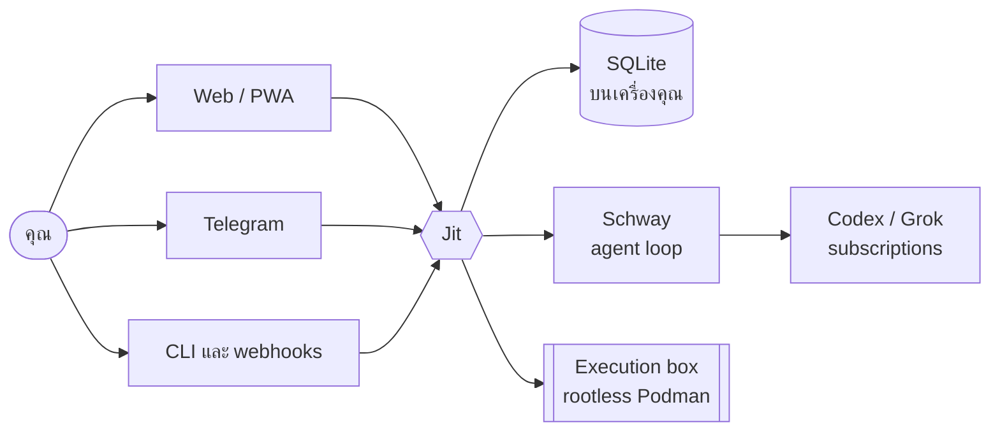

<div align="center">

<picture>
  <source media="(prefers-color-scheme: dark)" srcset="docs/design/assets/lockup-dark.svg">
  
</picture>

### Just in time. Just for you.

ทีม AI ส่วนตัวสำหรับโครงการซอฟต์แวร์ ที่รันบนเครื่องของคุณเอง<br>
คุยกับผู้ช่วยหลักคนเดียว เรียกผู้เชี่ยวชาญมาช่วยเมื่อจำเป็น แล้วกลับมาทำต่อได้ในวันถัดไป

[](LICENSE)
[](https://bun.sh)
[](tsconfig.json)
[](docs/runbooks/ops-service.md)

[English](README.md) · **ไทย**


</div>

---

## Jit คืออะไร

Jit คือผู้ช่วยส่วนตัวที่รันบนเครื่องที่คุณควบคุมเอง เช่น Raspberry Pi คุณคุยกับ **จิต** ซึ่งเป็นบอทหลัก จิตตอบทุกข้อความ เสนอผู้เชี่ยวชาญเมื่อหัวข้อนั้นต้องใช้ และขอให้แต่ละคนวิเคราะห์แยกกัน จิตจำการตัดสินใจ งาน และที่มาของข้อมูลได้ข้ามโครงการและข้ามวัน

Jit ใช้ [Schway](https://github.com/chayapats/schway) เป็น execution engine โดย Schway รับผิดชอบ agent loop และ provider sessions ส่วน Jit ดูแลที่เหลือทั้งหมด ได้แก่ โครงการ ทีม memory งาน jobs และช่องทางสื่อสาร

## จุดเด่น

|  |  |
| --- | --- |
| **คุยเป็นหลัก** | Web แบบ Grok มีทั้งโหมดมืดและสว่าง ใช้ได้ทั้งไทยและอังกฤษ และติดตั้งเป็น PWA ได้ |
| **ทีมที่เรียกได้เมื่อต้องการ** | จิตร่าง specialist เป็นการ์ด และ role จะเกิดขึ้นจริงก็ต่อเมื่อคุณกด **สร้าง** จิตเรียก role ที่มีอยู่ได้เองภายใน allowance ที่คุณตั้งเท่านั้น |
| **Memory ที่มีที่มา** | ข้อมูลทุกข้อโยงกลับไปยังที่มาได้ คุณแก้หรือสั่งให้ลืมได้ แล้วการเปลี่ยนแปลงจะมีผลทุกที่ที่ข้อมูลนั้นถูกใช้ |
| **งานที่คุณยอมรับเอง** | ข้อเสนอจะกลายเป็นงานก็ต่อเมื่อคุณยอมรับ revision นั้นตรงๆ และการยอมรับงานไม่ได้สั่งให้เริ่มทำงาน |
| **ตรวจ PR แบบส่วนตัว** | จิตอ่าน PR ใหม่โดยไม่รันโค้ด แล้วแจ้งสิ่งที่พบพร้อมหลักฐานให้คุณคนเดียว |
| **เงียบเป็นค่าเริ่มต้น** | งานตามตารางเวลาที่ไม่มีอะไรใหม่จะไม่ส่งข้อความ และคุณได้แจ้งเตือนครั้งเดียวเมื่องานทั้งชุดจบ เลือกได้ว่าจะรับทุกเรื่องหรือเฉพาะเรื่องที่รอคุณ |
| **รันงานใน sandbox** | แต่ละโครงการมี rootless Podman box ของตัวเอง ระดับสิทธิ์มี Read, Workspace และ Full และมีแต่คุณที่เพิ่มระดับได้ การ push, deploy และ external effect อื่นๆ ต้องรอให้คุณอนุมัติผ่าน approval card ก่อน |
| **เข้าถึงได้หลายทาง** | Web, CLI บน loopback (`jit ask`), signed webhooks และ `.ics` feed ของตารางงาน ช่องทาง Telegram เขียนไว้แล้ว แต่ build นี้ยังไม่มี Bot API transport ที่ใช้งานจริง |

## ทำงานอย่างไร



## หลักการ

- **อำนาจมาจากคุณเท่านั้น** ผลลัพธ์จาก model หรือเนื้อหาที่ดึงมาจะสร้าง role งาน หรือการตัดสินใจเองไม่ได้ และขยายสิทธิ์ไม่ได้
- **เสนอ ยอมรับ และทำเสร็จ แยกจากกันเสมอ** ทุกการเปลี่ยนแปลงมี revision และ receipt ให้ตรวจสอบได้
- **ข้อมูลอยู่บนเครื่องของคุณ** Jit ไม่ส่ง telemetry ข้อมูลออกไปเฉพาะยัง model providers ช่องทาง และ repositories ที่คุณตั้งค่าไว้
- **Credential ไม่เข้า box** ไม่มี credential, database หรือ backup ของ Jit เข้าไปใน execution box

## สถานะ

Jit อยู่ในช่วง **pilot** กับ owner คนเดียว MVP และ specs S09–S11 ทำเสร็จแล้ว เมื่อ 2026-10-28 การติดตั้งบน Raspberry Pi 5 ผ่านการทดสอบ packaging, restart, reboot และ route readiness บน route **Codex** ส่วน route Grok เลื่อนไว้จนกว่า quota จะ reset และ Telegram ยังปิดไว้จนกว่าจะมี transport จริง แต่ละ installation รองรับ owner คนเดียว

## เริ่มต้นใช้งาน

ต้องมี [Bun](https://bun.sh) 1.4.2 ขึ้นไป การพัฒนาไม่ต้องใช้ subscription หรือ build ของ Schway

```sh
bun install --frozen-lockfile
bun run setup        # สร้าง owner (รหัสผ่าน 12–256 ตัว รับจาก terminal แบบไม่แสดงตัวอักษร)
bun start            # http://localhost:3000
```

เปิด `http://localhost:3000` เข้าสู่ระบบ แล้วทำขั้นตอน **ตั้งจิต** เพื่อตั้ง persona ของจิต ค่าเริ่มต้นจะตอบด้วย scripted fixtures ถ้าต้องการใช้ model จริงให้ตั้ง `JIT_RUN_PORT=schway` โดยก่อนหน้านั้น user ที่รัน Jit ต้องมี Secret Service ที่ปลดล็อกแล้วและ login provider ใน Schway แล้ว (ดู [Pi live round](docs/runbooks/pi-live-round.md) Round B)

> [!TIP]
> ถ้าลืมรหัสผ่าน ให้รัน `bun run owner:reset` บนเครื่องนั้น คำสั่งนี้เพิกถอน session เดิมและเก็บโครงการไว้ครบ ไม่มีการ reset จากระยะไกล

## การตั้งค่า

Jit อ่านค่าจาก environment variables ค่าที่ใช้บ่อย:

| Variable | ค่าเริ่มต้น | ใช้ทำอะไร |
| --- | --- | --- |
| `JIT_DATABASE` | `.local/jit.sqlite` | Database ของแอป (git ignore ไว้แล้ว, mode 0600) |
| `JIT_ORIGIN` | `http://localhost:3000` | Origin เดียวที่รับ ถ้าไม่ใช่ loopback ต้องเป็น HTTPS |
| `JIT_HOST` / `JIT_PORT` | `127.0.0.1` / `3000` | Address ที่ listen |
| `JIT_RUN_PORT` | `scripted` | `scripted` (fixtures) หรือ `schway` (route จริง) |
| `JIT_SESSION_SECONDS` | `28800` | อายุ browser session |

ดูรายการทั้งหมดพร้อมขีดจำกัดได้ที่ [`src/config.ts`](src/config.ts) ซึ่งรวมค่าของ jobs, Telegram และ execution box

> [!IMPORTANT]
> ถ้าจะเข้าจากเครื่องอื่น ให้วาง Jit หลัง HTTPS reverse proxy บน VPN ที่คงค่า `Host` ไว้ อย่าเปิด backend port ออกไปตรงๆ Jit ไม่เชื่อ `Forwarded` headers และการอยู่บน VPN ไม่ถือเป็นตัวตนของ owner

## Deploy

| คู่มือ | เนื้อหา |
| --- | --- |
| [ติดตั้งและอัปเกรด service](docs/runbooks/ops-service.md) | Build, plan, install และ upgrade systemd service |
| [Execution box](docs/runbooks/execution-box.md) | ตั้งค่า rootless Podman และ `box-doctor` |
| [Pi live round](docs/runbooks/pi-live-round.md) | เก็บหลักฐานเรื่อง host, subscription และ reboot บน Pi |
| [Load drill](docs/runbooks/ops-load-drill.md) | Drill ด้าน capacity และ release evidence |

## การพัฒนา

```sh
bun test             # deterministic: scripted models, protocol fixtures, fake clocks
bun run typecheck
```

ติดตามงานใน GitHub Issues ก่อนแก้พฤติกรรมของระบบ ให้อ่าน [`AGENTS.md`](AGENTS.md), [workflow](docs/agents/workflow.md), [spec](docs/specs/README.md) ที่เกี่ยวข้อง และ [ADRs](docs/adr) ของ spec นั้น

## เอกสาร

| | |
| --- | --- |
| [Product](docs/product/README.md) | Vision, PRD, architecture, security และ roadmap |
| [Specs](docs/specs/README.md) | MVP, S01, S09–S11 |
| [Contracts](docs/contracts) | สัญญาพฤติกรรมที่มี version |
| [ADRs](docs/adr) | การตัดสินใจด้าน architecture |
| [Design](docs/design/README.md) | Visual system, tokens และโลโก้ |
| [Glossary](CONTEXT.md) | คำศัพท์ของระบบ |

## License

[MIT](LICENSE) © Jit contributors ดู [NOTICE](NOTICE) สำหรับ attribution ของ Schway
